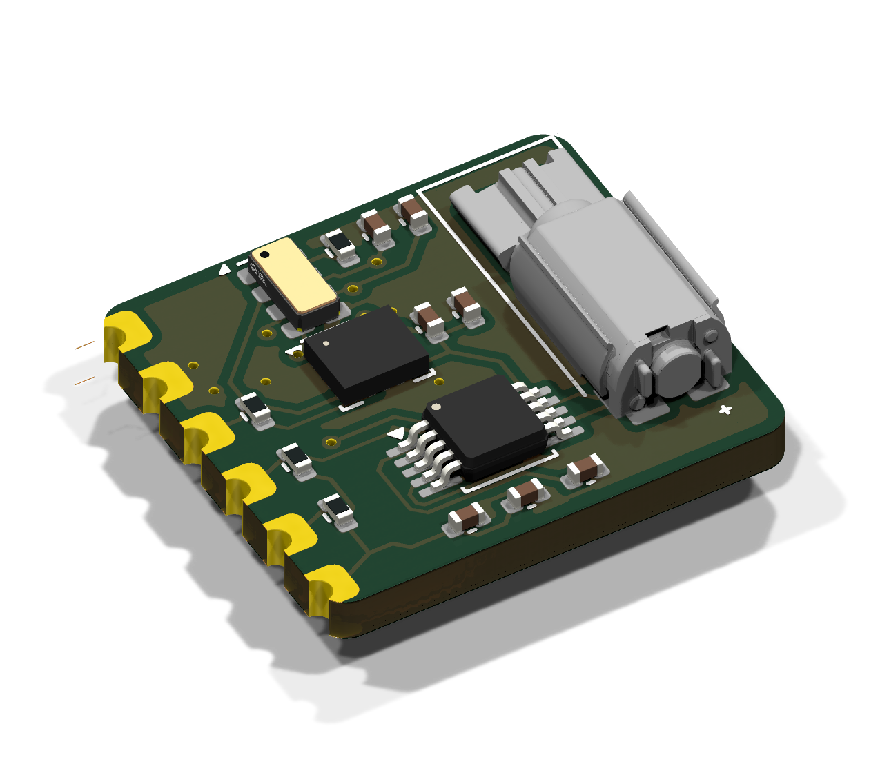
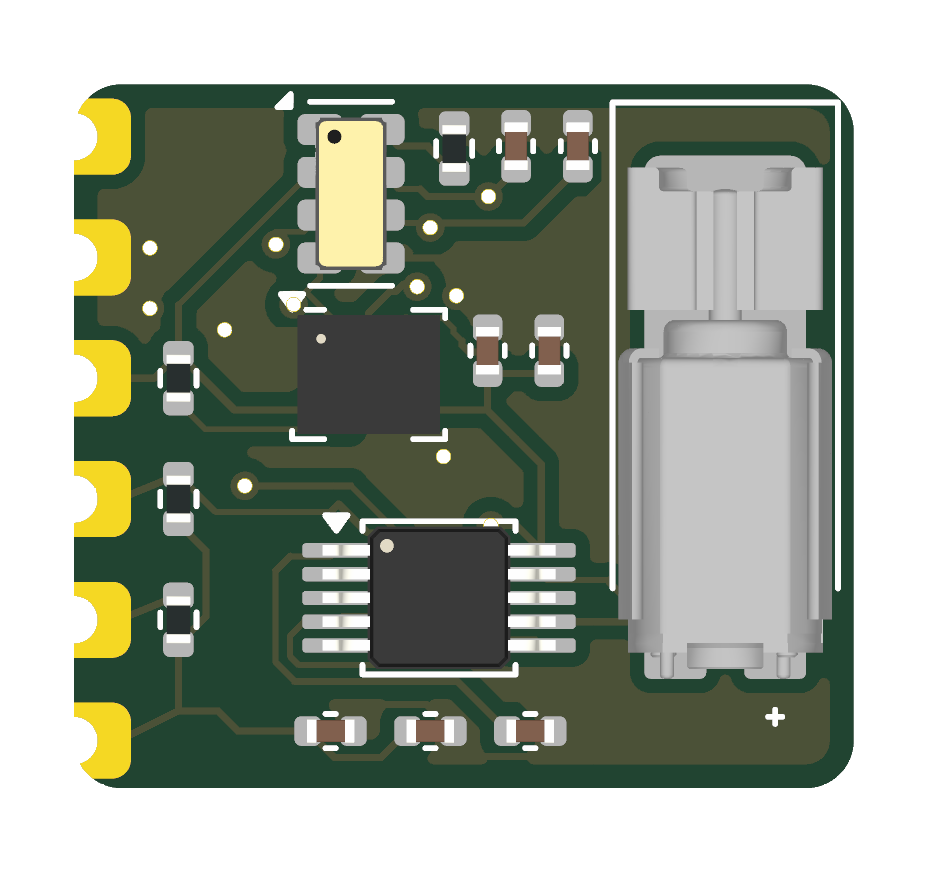
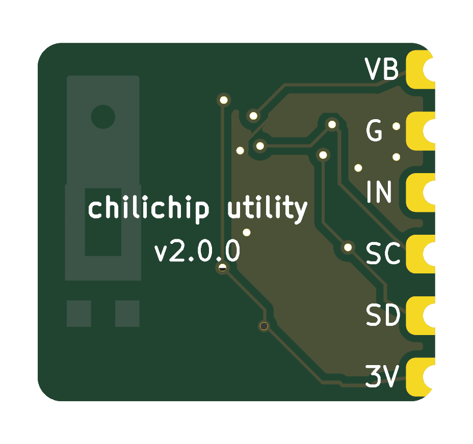

# chili-utility-module

KiCad 10 project for the **chilichip utility module**: a small add-on board for the [chilichip console](https://github.com/chili-chip/vgc-zero-hardware) with a gyroscope/accelerometer, a vibration motor and a real-time clock. Everything sits on one I²C bus, so the module needs only the console's three free GPIOs. The RTC is backed by the console's LiPo through its VSYS rail.

Status: **v2.0.0, schematic and PCB done.** The board is routed, DRC is clean (0 violations, 0 unconnected, matches the schematic), and ERC is clean.

v2.0.0 shrinks the board from 30 × 32 mm to 16.4 × 14.8 mm so it fits on the back of the console (with the RP2350-Plus and its LiPo) between the MCU, the battery and a display mounting hole:
- the CR1220 coin cell is gone: the RTC's backup input comes from the console's VSYS on a sixth castellation (VBAT);
- the 10 mm coin motor with wire leads is replaced by a reflow-solderable 4.3 mm SMD ERM (Vybronics VZ43FC1B5640007L).

  

| Top | Bottom |
|:---:|:---:|
|  |  |

## Parts

| Ref | Function | Part | LCSC |
|-----|----------|------|------|
| U1 | Gyro + accelerometer | **ST LSM6DS3TR-C**, 6-axis IMU, LGA-14 2.5 × 3 mm | [C967633](https://www.lcsc.com/product-detail/C967633.html) |
| U2 | Real-time clock | **Micro Crystal RV-3028-C7**, crystal built in, 45 nA, SON-8 1.5 × 3.2 mm | [C3019759](https://www.lcsc.com/product-detail/C3019759.html) |
| U3 | Haptic driver | **TI DRV2605L**, I²C ERM/LRA driver with 123 built-in effects, VSSOP-10 | [C527464](https://www.lcsc.com/product-detail/C527464.html) |
| M1 | Vibration motor | **Vybronics VZ43FC1B5640007L**, SMD cylindrical ERM, 4.3 × 4.5 × 12 mm, 3 V, 77 mA typ, reflow-solderable | not on LCSC: [Digi-Key 12323649](https://www.digikey.com/en/products/detail/vybronics-inc/VZ43FC1B5640007L/12323649) |
| C1–C4, C6 | Decoupling | 100 nF 0402, Samsung CL05B104KO5NNNC | C1525 |
| C5, C7 | Driver VDD / REG | 1 µF 0402, Samsung CL05A105KA5NQNC | C52923 |
| R1, R2 | I²C pull-ups | 4.7 kΩ 0402, UNI-ROYAL 0402WGF4701TCE | C25900 |
| R3, R4 | INT pull-up, EVI tie-down | 10 kΩ 0402, UNI-ROYAL 0402WGF1002TCE | C25744 |

Why these parts:
- **LSM6DS3TR-C:** active ST part at about $0.60–0.90, with mature drivers (ST's platform-independent C driver, Adafruit, NuttX).
- **RV-3028-C7:** no external crystal or load capacitors, ±1 ppm, and an automatic switchover to the backup supply (rated 1.1–5.5 V, so the console's VSYS at 3.4–4.95 V can feed it directly; about 115 nA in backup).
- **DRV2605L:** plays haptic effects over I²C, so the motor needs no PWM pin or MOSFET. That matters because the console has no GPIO left for one.

Alternatives considered:
- **QST QMI8658A** IMU: fewer drivers and no KiCad symbol.
- **NXP PCF85063A** RTC: needs an external crystal and draws about 5× more current.
- **MOSFET + flyback diode** for the motor: needs a spare PWM GPIO.
- **CR1220 coin cell** (v1): takes a 20 × 13 mm holder. The console's LiPo holds the RTC for years at 115 nA, as long as the console's off state cuts everything else.

## Connector J1 (to the console)

| Pin | Signal | Console | Notes |
|-----|--------|---------|-------|
| 1 | 3V3 | RP2350-Plus 3V3 | |
| 2 | SDA | GP0 (I2C0 SDA) | 4.7 kΩ pull-up R1 on the module |
| 3 | SCL | GP1 (I2C0 SCL) | 4.7 kΩ pull-up R2 on the module |
| 4 | INT | GP2 | open-drain, shared by IMU INT1 and RTC ~INT; 10 kΩ pull-up R3 |
| 5 | GND | GND | |
| 6 | VBAT | VSYS (pin 39) | RTC backup supply: always on while the console's LiPo is fitted, 3.4–4.95 V. 100 nF C4 at the RTC |

I²C addresses: IMU **0x6A** (SA0 to GND), RTC **0x52**, haptic driver **0x5A**.

GP0/GP1 are also the RP2350's default UART0 pins, so with this module fitted, use USB serial for debug output.

## Firmware setup the hardware relies on

- **IMU:** set INT1 to open-drain (`CTRL3_C` bit `PP_OD = 1`) before enabling any interrupt, because it shares the INT line with the RTC.
- **RTC:**
  - Enable backup switchover in level-switching mode (`BSM = 11` in register 37h) and store it to EEPROM. Switchover is disabled when the chip ships.
  - Leave the trickle charger off (`TCE = 0`, the default): VBACKUP is fed from the console's VSYS, never charged from VDD.
  - CLKOUT outputs 32.768 kHz by default; turn it off to save current.
- **Haptic driver:** select ERM mode and the ERM effect library, then run auto-calibration once for the motor (rated 3.0 V, 2.5–3.4 V operating). The motor's leads are swapped (OUT+ to its − pad) to keep the traces apart; an ERM vibrates the same in either direction. EN is tied high, so put the driver in standby through the `MODE` register when idle.

## ERC

ERC is clean. The project's `LSM6DS3TR-C` symbol has four pin types adjusted from KiCad's original, all matching how this design uses them:
- INT1/INT2 are open-collector, because firmware always sets them to open-drain so they can share the INT line with the RTC.
- SDO/SA0 and SDx are passive, because they're tied to GND: SA0 as an address strap, SDx as the unused auxiliary I²C master.

## Still to check

- **IMU SDx/SCx tie-off:** I tied them to GND, which is what secondary pin summaries say ("connect to VDDIO or GND" when unused). Check this against ST's LSM6DS3TR-C datasheet (DocID030071) pin table.
- **Power budget:** the motor draws about 77 mA (100 mA max) at 3 V while running, from the RP2350-Plus's 3.3 V output.
- **Motor sourcing:** the VZ43FC1B isn't stocked by LCSC. For JLCPCB assembly, use their global sourcing (Digi-Key) or consign the parts, or pick an LCSC-stocked SMD ERM with the same land pattern.

## Footprints

| Ref | Footprint | Source |
|-----|-----------|--------|
| J1 | `Castellated_1x06_P2.54mm` | Same castellated pads as the audio and buttons modules: 1.0 mm drill, 2.4 × 1.6 mm, on the board edge |
| M1 | `Motor_ERM_SMD_Vybronics_VZ43FC1B` | Vybronics datasheet land pattern: frame pad 3.4 × 9 mm (no net), terminals 1.3 × 1.4 mm. The counterweight end overhangs the frame pad and must stay clear |
| U2 | `MicroCrystal_C7_SON-8_1.5x3.2mm_P0.9mm` | Copy of KiCad's footprint, because KiCad 10 doesn't ship the 3D model it references |
| U1, U3, passives | KiCad standard library | |

**3D models:** U1, U3 and the passives use KiCad's library models. U2 uses LCSC's STEP model (from their EasyEDA library) and M1 Vybronics' STEP model, stored in `3d-models/`.

## PCB

- **Board:** 16.4 × 14.8 mm, 2 layers, all parts on the top side, 4.3 mm tall at the motor. The bottom sits flat on the back of the console once J1's castellations are soldered; the console's `UtilityModule` footprint has the matching lands.
- **Placement:**
  - J1 on the left edge, with the I²C/INT pull-ups in a column next to their castellations.
  - RTC at the top (next to VBAT), IMU below it, haptic driver at the bottom, each with its capacitors to its right.
  - Motor along the right edge, terminals at the bottom next to the driver's outputs.
- **Ground:** GND pour on both layers. SMD pads connect solid, through-hole pads through thermal spokes, and J1's GND castellation solid.
- **Routing:** autorouted with Freerouting, GND included as tracks, with keep-outs along the edges and between the castellations for the 0.5 mm copper-to-edge clearance. Tracks are 0.15 mm, necked to 0.125 mm where they pass fine-pitch pads, with 0.15 mm clearance; JLCPCB's minimum is 0.127 mm (DRC minimum set to 0.12 mm).
- **Silkscreen:** the version on top; J1 pin labels (VB, G, IN, SC, SD, 3V) and the module name on the bottom, since the top has no room. Reference designators are on the fab layer.

## Ordering from JLCPCB

Every tagged release has `chili-utility-module-<version>-gerbers.zip`, `-bom.csv` and `-cpl.csv` attached. Run `scripts/export-jlcpcb.sh` to build them locally into `production/`.

1. Upload the gerber zip on [jlcpcb.com](https://jlcpcb.com/) and select **2 layers, 1.6 mm, Castellated Holes: Yes**.
2. Turn on **PCB Assembly** (top side) and upload the BOM and CPL.
3. In the placement preview, check pin 1 of U1–U3 and the motor's orientation (terminals at the bottom, next to U3).
4. The motor (M1) has no LCSC part number: source it through JLCPCB global sourcing or consign it. Don't wash the board after assembly: the motor must not get flux washes or conformal coating.

CI runs ERC, DRC and the export on every push and pull request. A `v*` tag publishes a release with the files attached.

## Files

| Path | Contents |
|------|----------|
| `chili-utility-module.kicad_sch` | Schematic |
| `chili-utility-module.kicad_sym`, `sym-lib-table` | Project symbols: LSM6DS3TR-C, RV-3028-C7, DRV2605L, Motor_ERM. Copied from KiCad 10's library, with manufacturer, part number and LCSC fields added |
| `chili-utility-module.pretty/`, `fp-lib-table` | Project footprints: J1 castellated 1×06, M1 Vybronics SMD motor, U2 SON-8 |
| `3d-models/` | STEP models for M1 and U2 |
| `chili-utility-module.kicad_pcb` | PCB |
| `scripts/export-jlcpcb.sh` | Builds the JLCPCB gerber zip, BOM and CPL |
| `scripts/render-images.sh` | Regenerates the renders in `docs/images/` |
| `.github/workflows/main.yml` | CI and release workflow |
